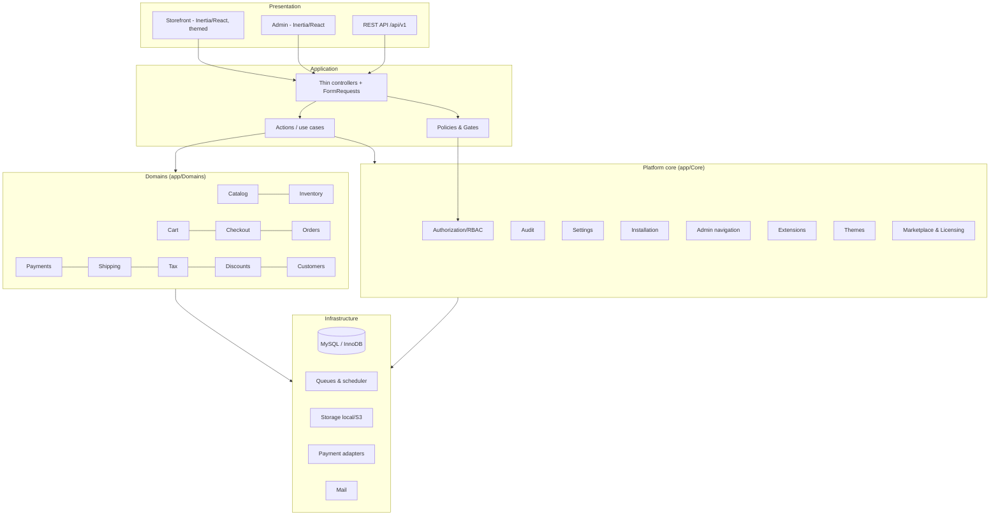

# Architecture Overview

EcoModular is a self-hosted, MIT-licensed eCommerce platform built as a **modular monolith** on Laravel 13, with a React + TypeScript + Inertia admin and storefront.

## 1. Repository assessment (Phase 0, 2026-10-12)

| Item                  | Finding                                                                                                                                           |
| --------------------- | ------------------------------------------------------------------------------------------------------------------------------------------------- |
| Repository state      | New project. Only the master specification existed; no prior code to preserve.                                                                    |
| PHP                   | Default `php` on PATH is 8.2.29 (**unsupported** by Laravel 13). PHP 8.4.25 at `C:\php84` is used.                                                |
| Composer / Node / npm | 2.9.2 / 24.14.0 / 11.9.0                                                                                                                          |
| Laravel               | `laravel/framework` 13.35.0 (requires `php ^8.3`)                                                                                                 |
| Frontend              | React 19.2, TypeScript 5, Inertia 3.9, Vite 8 (`vite-plus`), Tailwind CSS 4                                                                       |
| Auth                  | Laravel Fortify 1.37 (login, registration, verification, reset, 2FA, passkeys)                                                                    |
| Database              | No local MySQL; Docker daemon not running. SQLite used for tests; MySQL 8.4 via Docker Compose and CI.                                            |
| Redis                 | Listening on 127.0.0.1:6379 locally (optional).                                                                                                   |
| Baseline checks       | 40 PHPUnit tests pass; production build passes; `tsc` failed on a starter-kit Wayfinder/`Route::redirect` defect (see ADR-011, fixed in Phase 1). |

## 2. Layers



## 3. Directory layout

```text
app/
  Core/
    Authorization/   Roles, permissions, PermissionRegistry, escalation guard
    Audit/           AuditLogger, AuditLog model, redaction
    Settings/        Settings repository (cached, typed accessors)
    Installation/    Installer state, requirement checks, owner creation
    Admin/           AdminNavigation registry
    Extensions/      (Phase 4) manifests, lifecycle, registry
    Themes/          (Phase 5)
    Marketplace/     (Phase 6)
    Licensing/       (Phase 6)
  Domains/           (Phase 2+) Catalog, Customers, Cart, Checkout, Orders, Payments,
                     Inventory, Shipping, Tax, Discounts
  Http/              Controllers (Admin/, Install/, Settings/), Middleware, Requests
  Policies/
  Providers/
modules/             (Phase 4) bundled & installed modules
themes/              (Phase 5) theme packages
resources/js/
  pages/admin/       Admin Inertia pages
  pages/install/     Web installer
  pages/auth/, settings/  Account pages (Fortify)
  components/, layouts/
docs/
tests/Unit, tests/Feature, tests/Architecture
```

## 4. Request flow & enforcement

1. Route middleware: `auth`, `verified`, `staff` (has ≥1 role, not disabled), `can:<permission>`.
2. FormRequest validates and authorizes.
3. Controller delegates to an Action; Action enforces invariants (e.g., escalation guard) and writes audit entries inside a DB transaction where state changes.
4. Inertia response; shared props include the user's permission list (for UI hints only) and the permission-filtered admin navigation.

## 5. Key invariants

- Authorization is decided on the server; the UI only hides what the server already forbids.
- Only Owners can grant the Owner role; nobody can edit their own roles; the last active Owner cannot be removed or disabled.
- Audit records are append-only and redact secrets.
- The installer is unusable after installation and requires a server-side token before it.
- Money is never a float (ADR-007). Prices, taxes, discounts, and totals are always recalculated on the server (Phase 2).

## 6. Extension model (preview — implemented in Phase 4/5)

- Modules: `modules/<vendor>/<name>/module.json` (data-only manifest, JSON-schema validated), a declared service provider, declared permissions/capabilities. Lifecycle: discovered → validated → installed → enabled ⇄ disabled → update pending → failed. Nothing is auto-enabled; enabling executable code requires explicit administrator confirmation.
- Themes: data-only manifest + React component bundle registered against stable component contracts; checkout/payment logic stays in core.

See `docs/extensions/*` for the developer contracts as they are implemented.
